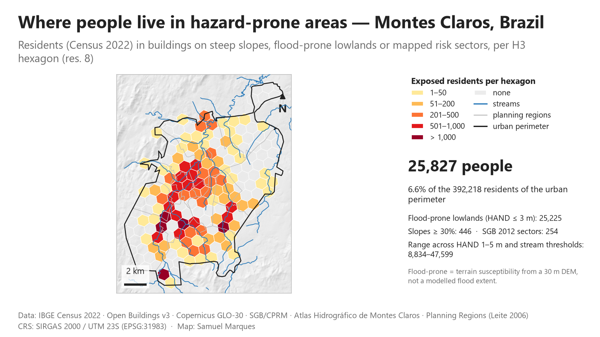
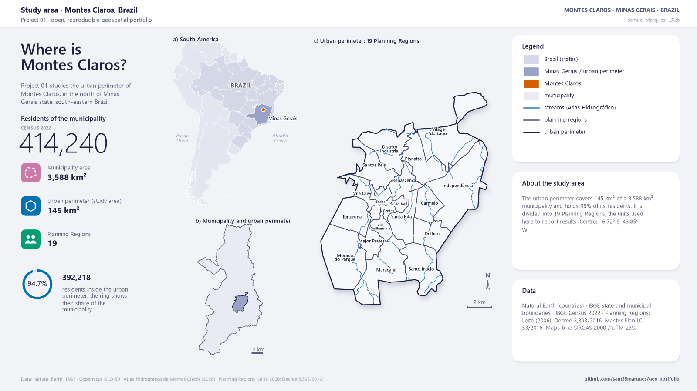
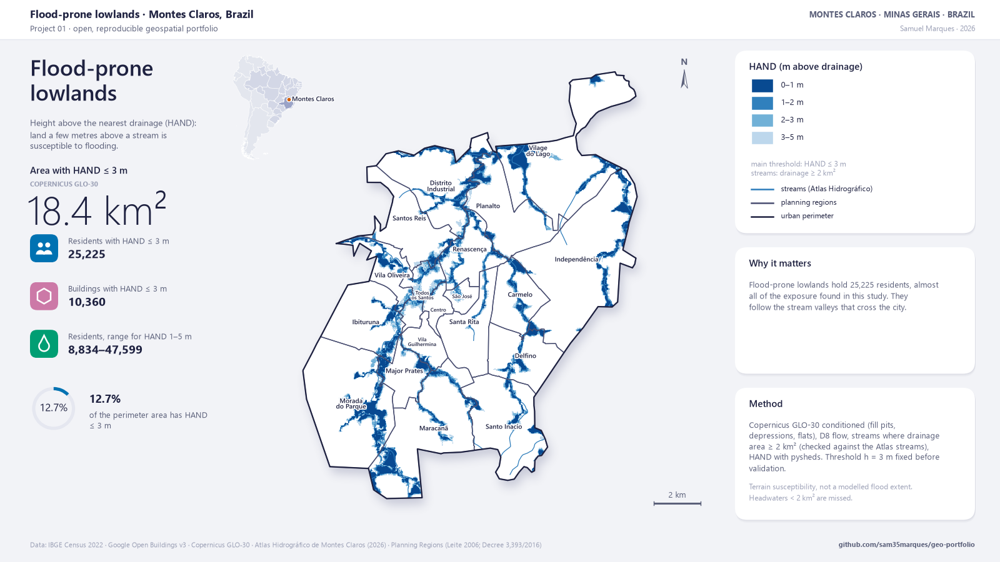
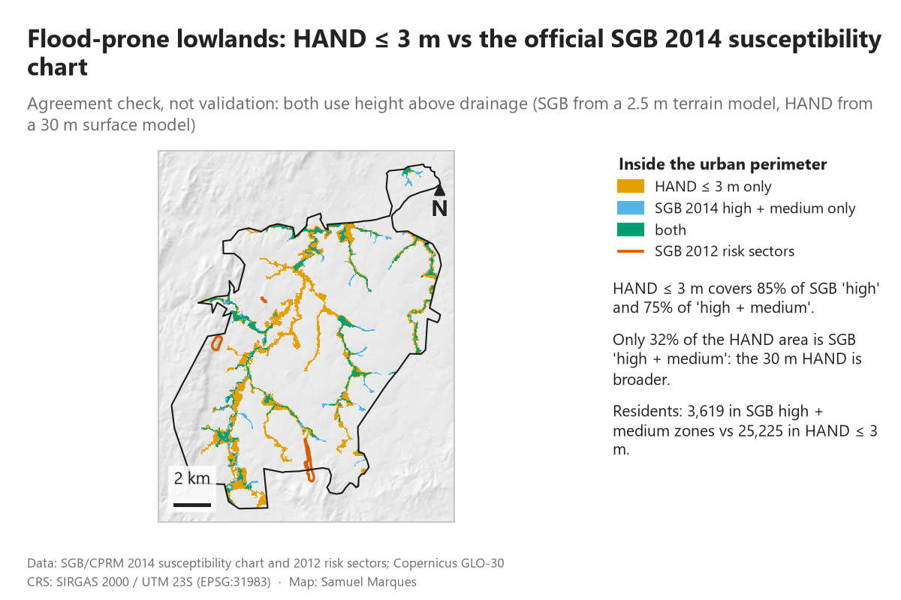
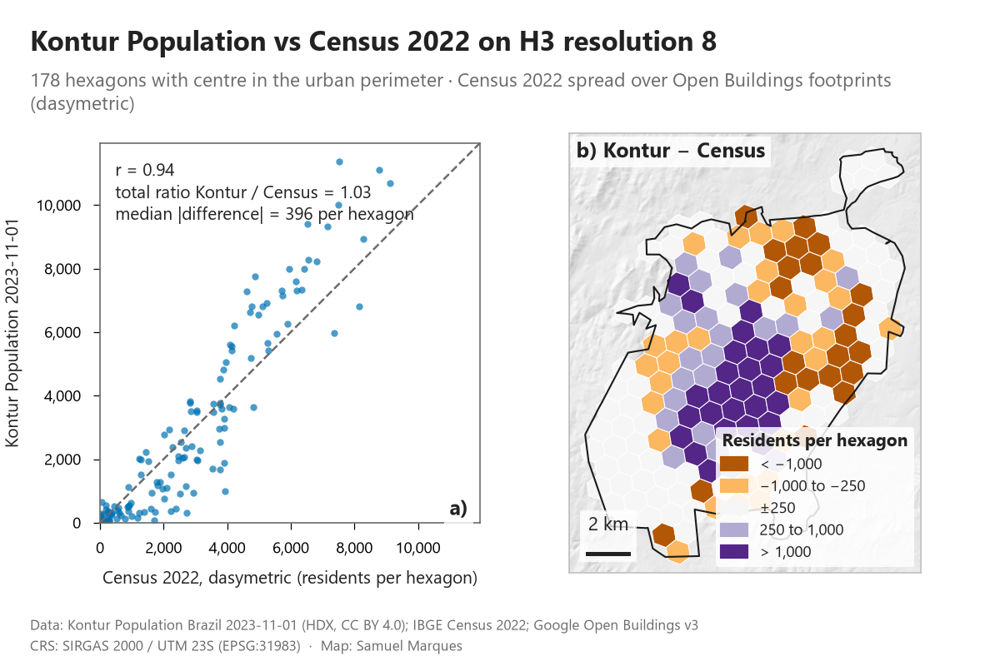

# Hazard exposure in Montes Claros, Brazil

**About 25,800 residents (6.6% of the urban population) live in buildings that sit on flood-prone low ground or on steep slopes in Montes Claros, Minas Gerais.**



[Project page](https://sam35marques.github.io/geo-portfolio/projects/hazard-exposure-montes-claros.html) · [Interactive map](https://sam35marques.github.io/geo-portfolio/projects/hazard-exposure-montes-claros/exposure_map.html) (H3 r8, no restricted geometries) · [One-page summary (PDF)](outputs/one-pager.pdf)

## Problem

Montes Claros is a city of 414,240 people (Census 2022) in northern Minas Gerais, Brazil. Its urban area grew along small streams and up the slopes of the surrounding hills. The Brazilian Geological Survey (SGB) has mapped flood and landslide risk sectors in the city since 2012. Local plans need to know *how many people* live in hazard-prone terrain and *where*, at a scale finer than the census tract. This study builds that estimate from open data only, and compares it with the official susceptibility chart and with a global population grid.

This is an **exposure** study. It counts people in hazard-prone areas. It does not estimate vulnerability, so it does not measure risk.



## Data

| Layer | Source | Resolution / scale | Date | Licence |
|---|---|---|---|---|
| Elevation | Copernicus DEM GLO-30 | 30 m | TanDEM-X, 2011–2015 | Copernicus DEM licence (free use with attribution) |
| Buildings | Google Open Buildings v3 | footprint polygons | v3 (2023) | CC BY 4.0 / ODbL |
| Population | IBGE Census 2022, tracts with attributes | census tract | 2022 | IBGE open data, cite source |
| Population (comparison) | Kontur Population, Brazil | H3 r8 (~0.7 km²) | release 2023-11-01 | CC BY 4.0 |
| Susceptibility (agreement check) | SGB/CPRM susceptibility chart, Montes Claros | 1:220,000 map; inundation classes from a 2.5 m DTM | 2014 | SGB public product, cite source |
| Risk sectors (qualitative check) | SGB/CPRM high-risk sectors | 4 polygons | 2012 | SGB public product, cite source |
| Urban perimeter | Planning Regions (Leite, 2006; Decree 3,393/2016) | 19 regions | 2016 | used with citation; **not redistributed** |
| Urban streams | Atlas Hidrográfico de Montes Claros (Leite & Marques, 2026) | digitized on 30 cm imagery | 2026 | used with citation; **not redistributed** |
| Base maps | Natural Earth; IBGE municipal and state meshes | 1:50M; IBGE | current | public domain; IBGE open data |

Full details (URLs, access dates, file names, citations): [`docs/DATA_SOURCES.md`](../../docs/DATA_SOURCES.md).

## Method

1. **Study area.** The union of the 19 Planning Regions defines the urban perimeter (145.2 km²). It holds 94.7% of the municipal population.
2. **Terrain.** GLO-30 tiles are mosaicked and reprojected to SIRGAS 2000 / UTM 23S (EPSG:31983) at 30 m. Slope is computed with Horn's method. "Steep" means slope ≥ 30%, the limit for urban subdivision in Brazilian law (Lei 6.766/79).
3. **Drainage and HAND.** Flow routing (pysheds) runs on a domain that extends 25 km beyond the perimeter, so upstream areas are not cut. Streams start at a 2 km² contributing area. This threshold was chosen by comparing derived streams with the Atlas streams (see Limitations). HAND (Height Above Nearest Drainage) gives each cell its height above the stream it drains to. "Flood-prone" means HAND ≤ 3 m. This value was fixed before any comparison with the SGB chart.
4. **Building footprints.** Open Buildings v3 polygons with confidence ≥ 0.75 are exported from Google Earth Engine (`02_open_buildings_gee.js`).
5. **Dasymetric population.** Each tract's 2022 population is split among its buildings in proportion to footprint area. Tracts that extend past the export box keep only the population share of the area that is covered.
6. **Exposure.** A building is exposed when its representative point falls in a hazard zone: steep slope, flood-prone HAND, or an SGB 2012 high-risk sector. Results are summed by Planning Region and by H3 resolution 8 cell.
7. **Checks.** HAND and slope zones are compared with the SGB 2014 susceptibility classes. Population per H3 cell is compared with Kontur Population.
8. **Sensitivity.** The whole chain is rerun for HAND = 1, 2, 3 and 5 m, stream thresholds of 1, 2 and 3 km², and building confidence of 0.65, 0.70 and 0.75.

All decisions, with the alternatives considered, are logged in [`docs/DECISIONS.md`](../../docs/DECISIONS.md).

## Results

| Hazard zone (main parameters) | Buildings | Residents | Share of residents |
|---|---:|---:|---:|
| Flood-prone (HAND ≤ 3 m, streams ≥ 2 km²) | 10,360 | 25,225 | 6.43% |
| Steep slope (≥ 30%) | 116 | 446 | 0.11% |
| SGB 2012 high-risk sectors | 125 | 254 | 0.06% |
| **Any of the above** | **10,556** | **25,827** | **6.58%** |
| All buildings in the perimeter | 152,726 | 392,218 | 100% |

Source: [`outputs/tables/exposure_summary.csv`](outputs/tables/exposure_summary.csv) (confidence ≥ 0.75).

**Flood-prone low ground drives almost all the exposure.** The HAND ≤ 3 m zone covers 18.45 km², or 12.7% of the perimeter. Steep land covers 3.23 km² (2.2%), mostly on the hills at the edge of the city where few people live.



**Exposure is concentrated in a few regions.** Maracanã (4,369 residents), Renascença (2,939) and Major Prates (2,595) have the most exposed people. As a share of each region's population, the highest values are in Morada do Parque (31.0%), Ibituruna (22.5%) and Todos os Santos (22.0%). Full table: [`exposure_by_region.csv`](outputs/tables/exposure_by_region.csv).

**HAND agrees well with the official chart.** The HAND ≤ 3 m zone covers 85.4% of the area that SGB 2014 classifies as *high* inundation susceptibility, and 75.1% of *high + medium*. It is also broader: only 31.7% of the HAND zone falls in the high or medium classes. For slope, 86.2% of the steep area falls in the SGB *high* mass-movement class.



**The dasymetric population matches Kontur at the cell level.** Across 176 populated H3 r8 cells, Pearson r = 0.944 (R² = 0.891). Kontur's total is 3% higher (402,037 vs 390,500). Kontur gives fewer people to mid-density cells (ratio 0.73–0.74 for 501–3,000 people per cell) and more to the densest cells (ratio 1.12).



Steep slopes are shown in [`slope_steep.png`](outputs/figures/slope_steep.png).

## Limitations & sensitivity

- **The HAND threshold matters most.** With streams ≥ 2 km², exposed residents in the flood-prone zone range from 9,377 (HAND ≤ 1 m) to 42,044 (HAND ≤ 5 m). At HAND ≤ 3 m, the stream threshold moves the count from 23,256 (3 km²) to 28,894 (1 km²). See [`sensitivity_hand.csv`](outputs/tables/sensitivity_hand.csv).
- **Building confidence matters little for people.** "Any hazard" residents range from 25,827 (confidence 0.75) to 26,239 (0.65). The building count changes more (10,556 to 15,799), because low-confidence detections are small and get little population. See [`sensitivity_ob_confidence.csv`](outputs/tables/sensitivity_ob_confidence.csv).
- **HAND is a terrain index, not a flood model.** It has no rainfall, discharge, return period or drainage network. It marks low ground near streams, not areas that flood with a given probability.
- **30 m DEM in a dense city.** GLO-30 is a surface model: roofs and trees raise the elevation, and canalized streams under streets are not visible in the terrain. Small streams and narrow valleys are smoothed out.
- **Stream network.** At 2 km², the derived network has about the same length as the Atlas streams (ratio 0.98). Within 60 m, it finds 63.8% of the Atlas streams (96.3% of canalized reaches, 53.8% of natural reaches). Because the Atlas was used to choose the threshold, it is not an independent validation of the network.
- **The SGB comparison is agreement, not validation.** The 2014 chart also defines inundation classes from height above drainage, on a different DEM. Agreement is expected in part by construction. The 2012 sectors are only four polygons, so they serve as a qualitative check. The 2012 flood sector in Vila Itatiaia – Santa Rafaela lies at the head of a small stream: only 7.5% of its cells have HAND ≤ 3 m, so the 2 km² network misses it.
- **Population.** Census tracts are from 2022 and buildings from Open Buildings v3. Population per building assumes that people are spread by footprint area, so it ignores building height and use (commercial and industrial buildings get residents too). In the main run, 7 people could not be allocated (one tract with population and no detected buildings).
- **Exposure by representative point.** A building counts as exposed only if its representative point is inside the zone. Buildings that cross the zone edge can be counted either way.

## Reuse in another city

Nothing in the code is tied to Montes Claros. Every path, code and threshold comes from [`config/montes_claros.yaml`](../../config/montes_claros.yaml). To run another city:

1. Copy the YAML to `config/<city>.yaml`.
2. Change the IBGE municipality and state codes, the census and Kontur files, the GLO-30 tiles and the Open Buildings export box.
3. Set `aoi.source: "ibge_municipality"` if there is no urban perimeter layer.
4. Run the scripts with `--city <city>`.

The Atlas streams are used only to choose the stream threshold. Without a local reference, keep 2 km² and report the HAND sensitivity table.

## Stack

Python 3.11 (conda-forge): GeoPandas, Shapely 2, rasterio, rioxarray, pysheds, h3 v4, pandas, matplotlib, Folium. Google Earth Engine (JavaScript) for the Open Buildings export. Shared functions are in [`src/geoportfolio/`](../../src/geoportfolio/).

## How to reproduce

From the repository root:

```bash
mamba env create -f environment.yml
conda activate geoportfolio

python projects/01-hazard-exposure-montes-claros/scripts/01_download_data.py      # open data, with SHA-256 log
# 02_open_buildings_gee.js: run in the Earth Engine Code Editor, save the CSV to data/raw/buildings/open_buildings/
python projects/01-hazard-exposure-montes-claros/scripts/03_terrain.py            # mosaic, slope
python projects/01-hazard-exposure-montes-claros/scripts/04_hand.py               # flow routing, streams, HAND
python projects/01-hazard-exposure-montes-claros/scripts/05_buildings_population.py   # dasymetric population
python projects/01-hazard-exposure-montes-claros/scripts/06_exposure.py           # exposure and sensitivity
python projects/01-hazard-exposure-montes-claros/scripts/07_h3_kontur.py          # H3 r8, Kontur comparison
python projects/01-hazard-exposure-montes-claros/scripts/08_figures.py            # static maps
python projects/01-hazard-exposure-montes-claros/scripts/09_web_map.py            # interactive map
python projects/01-hazard-exposure-montes-claros/scripts/10_one_pager.py          # one-page PDF summary
python projects/01-hazard-exposure-montes-claros/scripts/11_site_assets.py        # copy outputs to the Quarto site
```

The Planning Regions and the Atlas streams are not distributed here (see Data). To reproduce the Montes Claros run exactly, request them from their authors and save them at the paths listed in the YAML.

## Credits & citation

Author: Samuel Marques. Code under the MIT licence; text and figures under CC BY 4.0.

Data: Copernicus DEM GLO-30 (© DLR e.V. 2010–2014 and © Airbus Defence and Space GmbH 2014–2018, provided under COPERNICUS by the European Union and ESA); Google Open Buildings v3 (Sirko et al., 2021); IBGE, Censo Demográfico 2022; Kontur Population (2023); CPRM/SGB (2012, 2014); Leite (2006) and Montes Claros Decree 3,393/2016 for the Planning Regions; Leite & Marques (2026), *Atlas hidrográfico de Montes Claros – MG*, Editora Unimontes, ISBN 978-85-7739-852-2; Natural Earth.

Suggested citation:

> Marques, S. (2026). *Hazard exposure in Montes Claros, Brazil: an open-data estimate with HAND, slope and dasymetric population*. geo-portfolio. https://github.com/sam35marques/geo-portfolio
