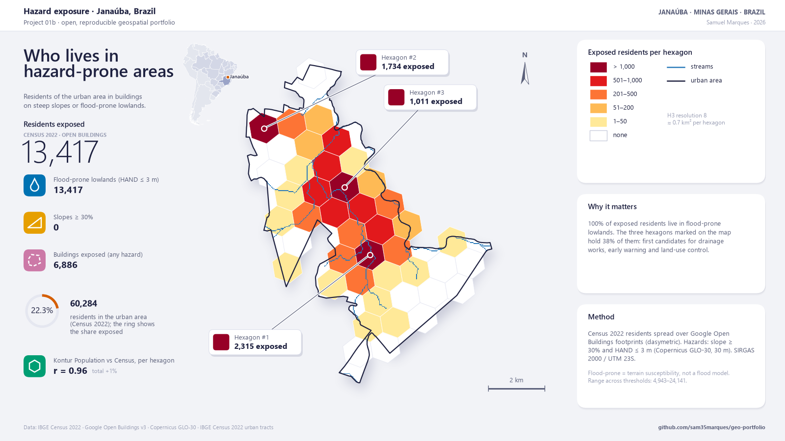
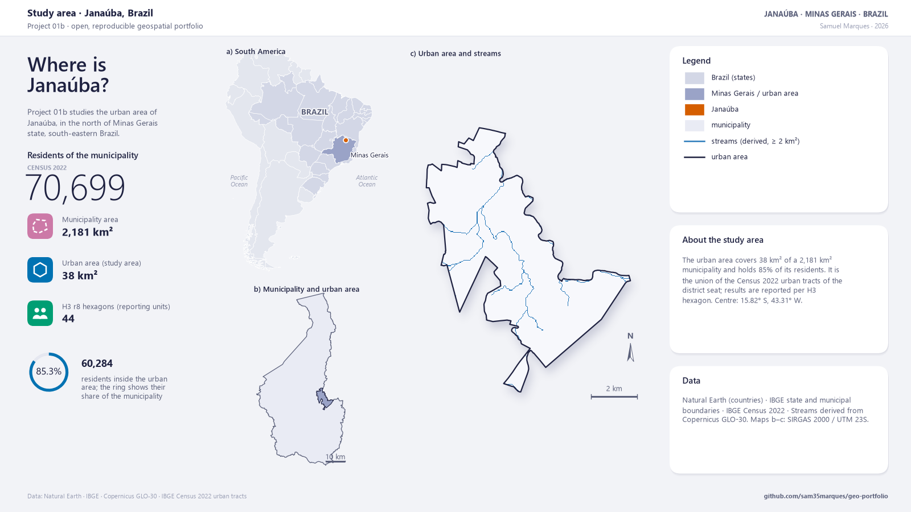
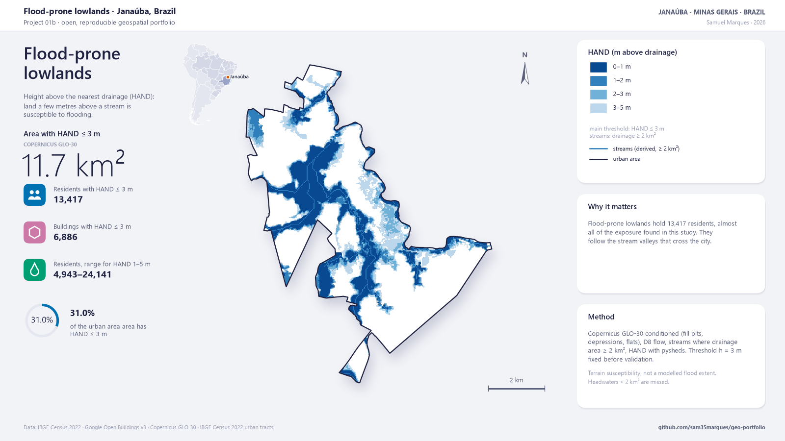
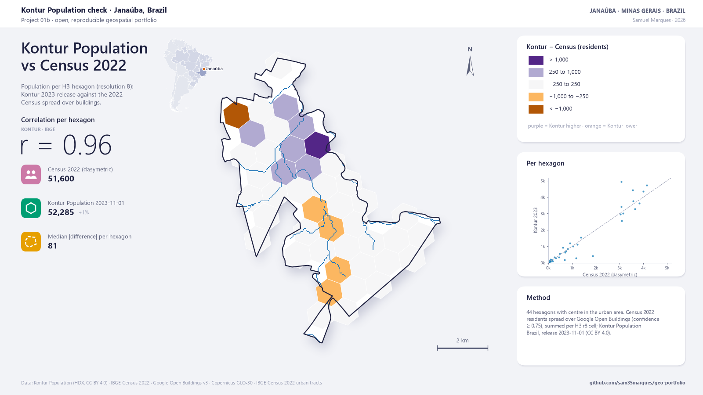

# Hazard exposure in Janaúba, Brazil

**About 13,400 residents (22.3% of the urban population) live in buildings on flood-prone low ground in Janaúba, Minas Gerais.**



[Project page](https://sam35marques.github.io/geo-portfolio/projects/hazard-exposure-janauba.html) · [Interactive map](https://sam35marques.github.io/geo-portfolio/projects/hazard-exposure-janauba/exposure_map.html) (H3 r8) · [One-page summary (PDF)](outputs/one-pager.pdf)

This is the [Montes Claros hazard-exposure study](../01-hazard-exposure-montes-claros/) run for a second city. The code and parameters are the same; only the city configuration ([`config/janauba.yaml`](../../config/janauba.yaml)) changes.

## Problem

Janaúba is a city of 70,699 people (Census 2022), the second most populous in the semi-arid region of Minas Gerais. The Gorutuba River, a tributary of the Verde Grande and part of the São Francisco basin, crosses the urban area. Upstream, on the border with Porteirinha, the Bico da Pedra reservoir regulates its flow. The city is flat and much of it sits on low ground near the river and its tributaries. There is no official susceptibility chart or risk-sector map for Janaúba, so an open estimate of who lives on flood-prone ground fills a gap. This study builds it from open data only.

This is an **exposure** study. It counts people in hazard-prone areas. It does not estimate vulnerability, so it does not measure risk.



## Data

| Layer | Source | Resolution / scale | Date | Licence |
|---|---|---|---|---|
| Elevation | Copernicus DEM GLO-30 | 30 m | TanDEM-X, 2011–2015 | Copernicus DEM licence (free use with attribution) |
| Elevation (sensitivity only) | FABDEM V1-2 (Hawker et al., 2022), bare earth | 30 m | based on GLO-30 | CC BY-NC-SA 4.0; **only aggregate tables published** |
| Buildings | Google Open Buildings v3 | footprint polygons | v3 (2023) | CC BY 4.0 / ODbL |
| Population and urban area | IBGE Census 2022, tracts with attributes | census tract | 2022 | IBGE open data, cite source |
| Population (comparison) | Kontur Population, Brazil | H3 r8 (~0.7 km²) | release 2023-11-01 | CC BY 4.0 |
| Base maps | Natural Earth; IBGE municipal and state meshes | 1:50M; IBGE | current | public domain; IBGE open data |

Full details (URLs, access dates, file names, citations): [`docs/DATA_SOURCES.md`](../../docs/DATA_SOURCES.md).

## Method

1. **Study area.** Janaúba has no open urban-perimeter layer. The study area is the union of the Census 2022 tracts classed as urban (high- and low-density urban area) in the district seat: 37.9 km², with 85.3% of the municipal population.
2. **Terrain.** GLO-30 tiles are mosaicked and reprojected to SIRGAS 2000 / UTM 23S (EPSG:31983) at 30 m. Slope is computed with Horn's method. "Steep" means slope ≥ 30% (Brazilian law 6,766/1979).
3. **Drainage and HAND.** Flow routing (pysheds) runs on a domain that extends 25 km beyond the urban area. Streams start at a 2 km² contributing area, the value used in Montes Claros; there is no local stream map to tune it. HAND (Height Above Nearest Drainage) gives each cell its height above the stream it drains to. "Flood-prone" means HAND ≤ 3 m.
4. **Building footprints.** Open Buildings v3 polygons with confidence ≥ 0.75 are exported from Google Earth Engine ([`scripts/gee_exports_janauba.js`](scripts/gee_exports_janauba.js)).
5. **Dasymetric population.** Each tract's 2022 population is split among its buildings in proportion to footprint area.
6. **Exposure.** A building is exposed when its representative point falls in a hazard zone (steep slope or flood-prone HAND). Results are summed by H3 resolution 8 cell; there are no named planning units.
7. **Check.** Population per H3 cell is compared with Kontur Population.
8. **Sensitivity.** The chain is rerun for HAND = 1, 2, 3 and 5 m, stream thresholds of 1, 2 and 3 km², building confidence of 0.65, 0.70 and 0.75, and on the bare-earth FABDEM.

All decisions are logged in [`docs/DECISIONS.md`](../../docs/DECISIONS.md).

## Results

| Hazard zone (main parameters) | Buildings | Residents | Share of residents |
|---|---:|---:|---:|
| Flood-prone (HAND ≤ 3 m, streams ≥ 2 km²) | 6,886 | 13,417 | 22.26% |
| Steep slope (≥ 30%) | 0 | 0 | 0% |
| **Any of the above** | **6,886** | **13,417** | **22.26%** |
| All buildings in the urban area | 32,311 | 60,284 | 100% |

Source: [`outputs/tables/exposure_summary.csv`](outputs/tables/exposure_summary.csv) (confidence ≥ 0.75).

**Flood-prone ground is the whole story.** The HAND ≤ 3 m zone covers 11.73 km², or 31.0% of the urban area. No detected building stands on slopes ≥ 30%: steep land covers only 0.70 km² (1.85% of the area), on the hills at the south-eastern edge, and the median slope is 2.7%.



**Exposure is concentrated.** The three H3 cells with most exposed residents hold 2,315, 1,734 and 1,011 people, 38% of the total. In two of them, 75% and 93% of the residents live on flood-prone ground. Table per cell: [`h3_population_comparison.csv`](outputs/tables/h3_population_comparison.csv).

**The dasymetric population matches Kontur at the cell level.** Across 41 populated H3 r8 cells, Pearson r = 0.959 (R² = 0.919). Kontur's total is 1.3% higher (52,285 vs 51,600).



Steep slopes are shown in [`slope_steep.png`](outputs/figures/slope_steep.png).

## Limitations & sensitivity

- **The HAND threshold matters most.** With streams ≥ 2 km², flood-prone residents range from 5,210 (HAND ≤ 1 m) to 22,217 (HAND ≤ 5 m). At HAND ≤ 3 m, the stream threshold moves the count from 10,968 (3 km²) to 15,702 (1 km²). See [`sensitivity_hand.csv`](outputs/tables/sensitivity_hand.csv).
- **The DEM matters too.** On the bare-earth FABDEM, residents with HAND ≤ 3 m rise to 17,161 (area 12.84 km² vs 11.73 km²); the two HAND ≤ 3 m zones overlap by 76% (Jaccard). See [`dem_sensitivity_exposure.csv`](outputs/tables/dem_sensitivity_exposure.csv).
- **Building confidence matters little for people.** Residents exposed range from 13,417 (confidence 0.75) to 13,500 (0.65); the building count changes more (6,886 to 9,518). See [`sensitivity_ob_confidence.csv`](outputs/tables/sensitivity_ob_confidence.csv).
- **No reference data.** There is no SGB/CPRM susceptibility chart or risk-sector map for Janaúba (RIGEO search, 2026-11-25) and no local stream map. The HAND zone is not checked against any official layer, and the 2 km² stream threshold is borrowed from Montes Claros.
- **A large, regulated river.** HAND ≤ 3 m marks low ground next to any stream. On a river the size of the Gorutuba, floods can rise more than 3 m, and the Bico da Pedra reservoir changes the flow regime. HAND has no rainfall, discharge or return period: it is a terrain index, not a flood model.
- **Truncated basin.** The 25 km domain does not hold the whole Gorutuba basin. Upstream area is underestimated, but every stream ≥ 2 km² inside the city is still present, so HAND is not affected.
- **Cells without HAND.** 50 buildings (100 residents, 0.17%) drain to a closed low point before reaching a stream and have no HAND value; they count as not exposed. See [`hand_undefined.csv`](outputs/tables/hand_undefined.csv).
- **Study area from census tracts.** Urban tracts include some empty land at the edges (the long wedges in the maps). H3 cells are kept only when their centre is in the urban area and the whole cell is inside the building export box: the 44 cells hold 12,071 of the 13,417 exposed residents.
- **30 m surface model.** GLO-30 includes roofs and trees, and smooths small channels and short slopes.
- **Population.** Population per building follows footprint area and ignores building height and use.

## Reuse in another city

See [Reuse in another city](../01-hazard-exposure-montes-claros/README.md#reuse-in-another-city) in the Montes Claros study. This case study is that recipe applied: a copy of the YAML with the IBGE code, the urban-tract AOI rule, the GLO-30 tiles and the Open Buildings export box.

## Stack

Python 3.11 (conda-forge): GeoPandas, Shapely 2, rasterio, pysheds, h3 v4, pandas, matplotlib, Folium. Google Earth Engine (JavaScript) for the Open Buildings and FABDEM exports. Shared functions are in [`src/geoportfolio/`](../../src/geoportfolio/); scripts in [`projects/01-hazard-exposure-montes-claros/scripts/`](../01-hazard-exposure-montes-claros/scripts/).

## How to reproduce

From the repository root, after creating the environment (`mamba env create -f environment.yml`) and downloading the shared data (`01_download_data.py`, Montes Claros):

```bash
S=projects/01-hazard-exposure-montes-claros/scripts
python $S/01_download_data.py --city janauba        # GLO-30 tiles
# projects/01b-hazard-exposure-janauba/scripts/gee_exports_janauba.js: run in the Earth Engine Code Editor
python $S/03_terrain.py --city janauba
python $S/04_hand.py --city janauba
python $S/05_buildings_population.py --city janauba
python $S/06_exposure.py --city janauba
python $S/07_h3_kontur.py --city janauba
python $S/12_dem_sensitivity.py --city janauba
python $S/08_figures.py --city janauba
python $S/09_web_map.py --city janauba
python $S/10_one_pager.py --city janauba
python $S/11_site_assets.py --city janauba
```

## Credits & citation

Author: Samuel Marques. Code under the MIT licence; text and figures under CC BY 4.0.

Data: Copernicus DEM GLO-30 (© DLR e.V. 2010–2014 and © Airbus Defence and Space GmbH 2014–2018, provided under COPERNICUS by the European Union and ESA); FABDEM V1-2 (Hawker et al., 2022, *Environ. Res. Lett.* 17, 024016; produced using Copernicus WorldDEM-30 © DLR e.V. 2010–2014 and © Airbus Defence and Space GmbH 2014–2018, provided under COPERNICUS by the European Union and ESA); Google Open Buildings v3 (Sirko et al., 2021); IBGE, Censo Demográfico 2022; Kontur Population (2023); Natural Earth.

Suggested citation:

> Marques, S. (2026). *Hazard exposure in Janaúba, Brazil: an open-data estimate with HAND, slope and dasymetric population*. geo-portfolio. https://github.com/sam35marques/geo-portfolio
