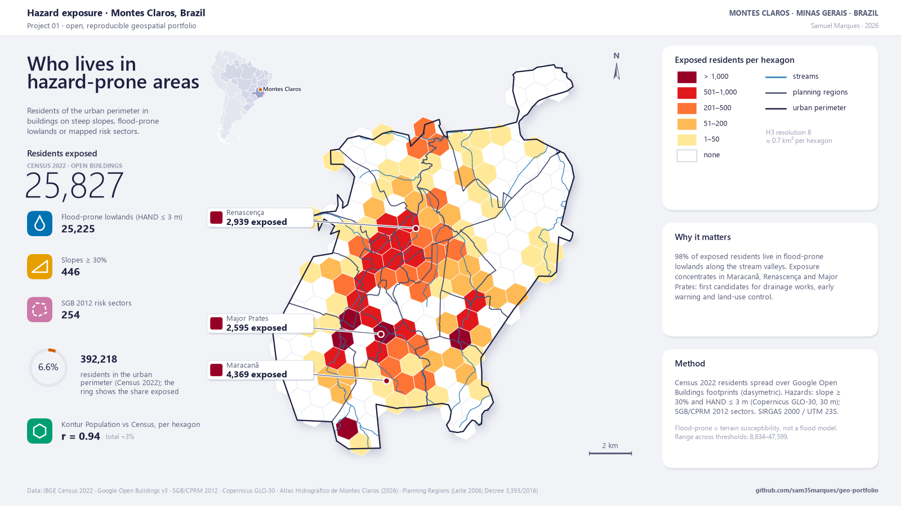

GIS analyst and geographer based in Montes Claros, Brazil. I build open, reproducible case studies with Python: hazard exposure, population on H3 grids, land-use scenarios and urban heat.

**First case study:** [Hazard exposure in Montes Claros](projects/hazard-exposure-montes-claros.qmd). About 25,800 residents live in buildings on flood-prone low ground or steep slopes.

[{fig-alt="Hazard exposure map of Montes Claros"}](projects/hazard-exposure-montes-claros.qmd)

More case studies are in progress. See [Projects](projects.qmd).
