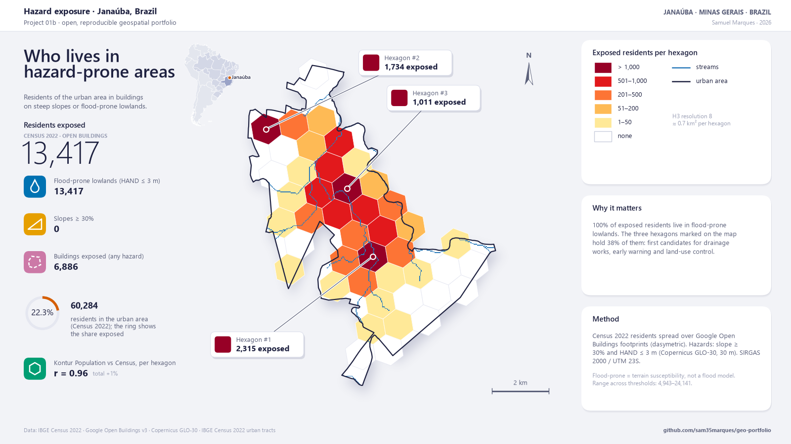
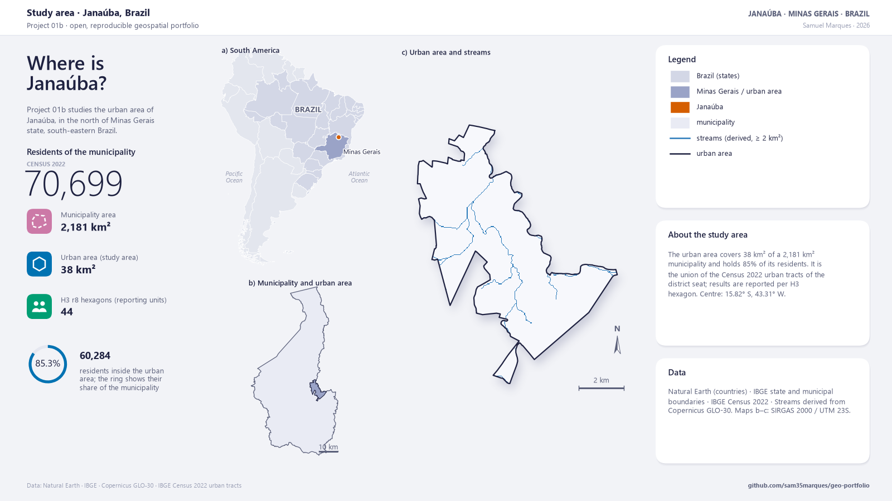
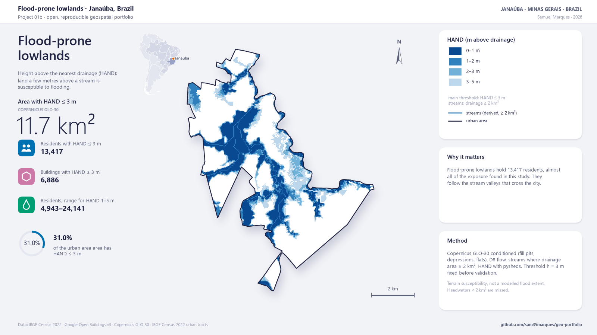
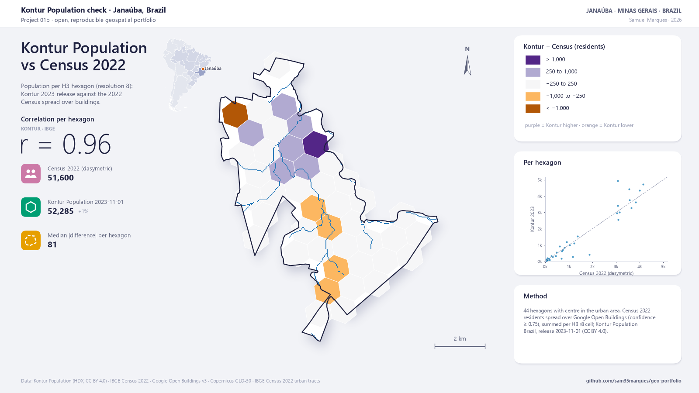
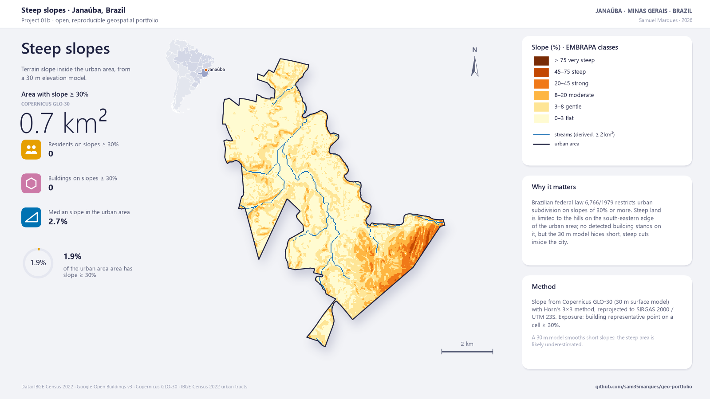

{fig-alt="Dashboard map of exposed residents per H3 hexagon in Janaúba"}

[Full case study and code on GitHub](https://github.com/sam35marques/geo-portfolio/tree/main/projects/01b-hazard-exposure-janauba){.btn .btn-primary}
[One-page summary (PDF)](hazard-exposure-janauba/one-pager.pdf){.btn .btn-outline-primary}
[Interactive map](hazard-exposure-janauba/exposure_map.html){.btn .btn-outline-primary}

This is the [Montes Claros study](hazard-exposure-montes-claros.qmd) run for a second city, with the same code and parameters. Only the city configuration file changes.

## Problem

Janaúba is a city of 70,699 people (Census 2022), the second most populous in the semi-arid region of Minas Gerais. The Gorutuba River, a tributary of the Verde Grande in the São Francisco basin, crosses the urban area; upstream, the Bico da Pedra reservoir regulates its flow. The city is flat, and there is no official susceptibility chart or risk-sector map for it. This study estimates, from open data only, how many people live on flood-prone ground and where.

This is an **exposure** study: it counts people in hazard-prone areas. It does not include vulnerability, so it does not measure risk.

{fig-alt="Location of Janaúba in South America, Brazil and Minas Gerais"}

## Method

1. **Study area:** Census 2022 urban tracts of the district seat (37.9 km², 85.3% of the municipal population). There is no open urban-perimeter layer.
2. **Terrain:** Copernicus GLO-30 at 30 m, reprojected to SIRGAS 2000 / UTM 23S. Slope by Horn's method; steep means ≥ 30%.
3. **HAND:** streams start at a 2 km² contributing area (as in Montes Claros). Flood-prone means HAND ≤ 3 m.
4. **Population:** Census 2022 tract population spread over Google Open Buildings v3 footprints (confidence ≥ 0.75), by footprint area.
5. **Exposure:** a building is exposed when its representative point falls in a hazard zone. Totals per H3 resolution 8 cell.
6. **Checks and sensitivity:** comparison with Kontur Population; reruns for HAND 1–5 m, streams 1–3 km², building confidence 0.65–0.75, and the bare-earth FABDEM.

## Results

| Hazard zone (main parameters) | Buildings | Residents | Share of residents |
|---|---:|---:|---:|
| Flood-prone (HAND ≤ 3 m, streams ≥ 2 km²) | 6,886 | 13,417 | 22.26% |
| Steep slope (≥ 30%) | 0 | 0 | 0% |
| All buildings in the urban area | 32,311 | 60,284 | 100% |

All the exposure is on flood-prone ground: the HAND ≤ 3 m zone covers 31.0% of the urban area. The three H3 cells with most exposed residents hold 38% of them.

{fig-alt="Flood-prone areas by HAND in Janaúba"}

Across 41 populated H3 r8 cells, the dasymetric estimate and Kontur Population agree with Pearson r = 0.959. Kontur's total is 1.3% higher.

{fig-alt="Kontur Population compared with the Census-based estimate per H3 cell"}

{fig-alt="Steep slopes in Janaúba"}

## Limitations

- With streams ≥ 2 km², flood-prone residents range from 5,210 (HAND ≤ 1 m) to 22,217 (HAND ≤ 5 m). On the bare-earth FABDEM, the HAND ≤ 3 m count is 17,161.
- No official reference exists for Janaúba, so the HAND zone is not checked against an SGB chart, and the stream threshold is borrowed from Montes Claros.
- HAND is a terrain index, not a flood model. On a large river regulated by a reservoir, floods can rise more than 3 m.
- GLO-30 is a 30 m surface model; population per building follows footprint area and ignores building height and use.

The full list, data table, licences and reproduction steps are in the [case study on GitHub](https://github.com/sam35marques/geo-portfolio/tree/main/projects/01b-hazard-exposure-janauba).

## Interactive map

<iframe src="hazard-exposure-janauba/exposure_map.html" width="100%" height="640" style="border:1px solid #E3E6EE; border-radius:8px;" title="Interactive map of exposed residents per H3 hexagon in Janaúba"></iframe>
