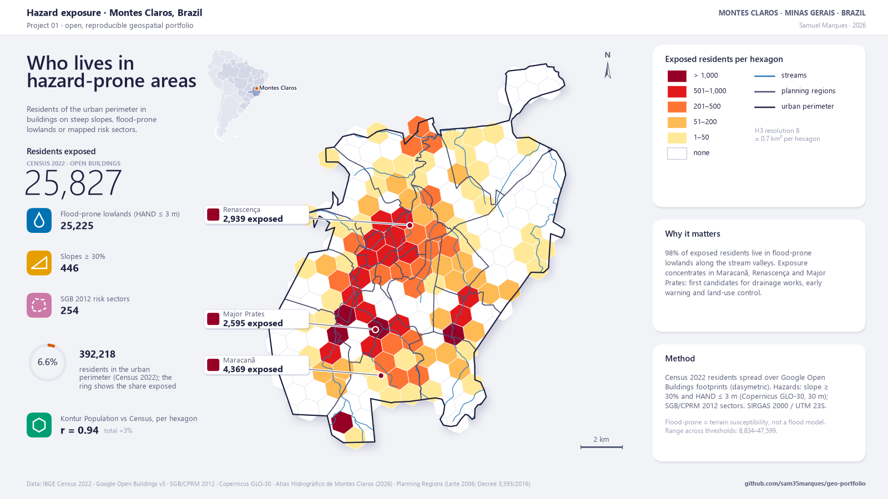
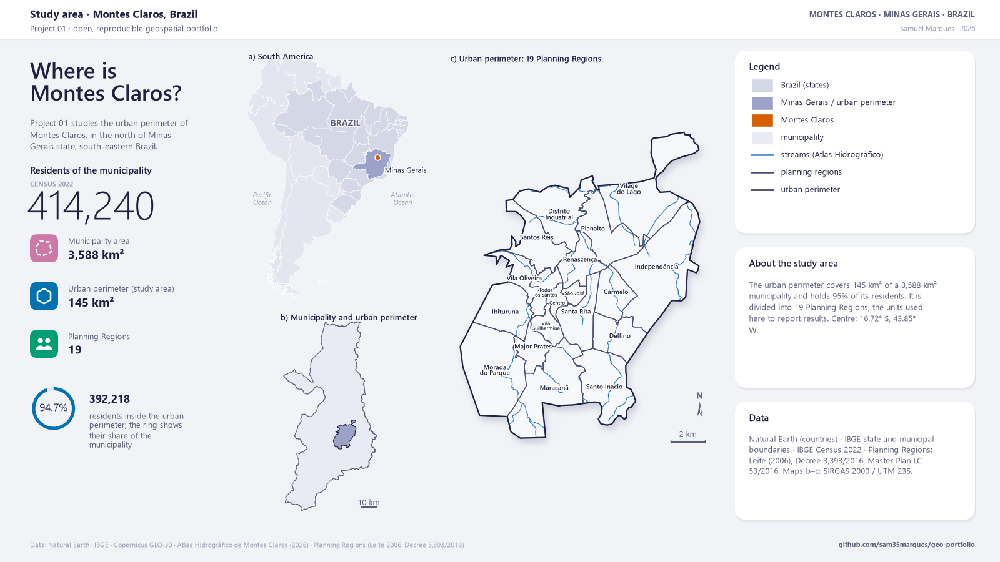
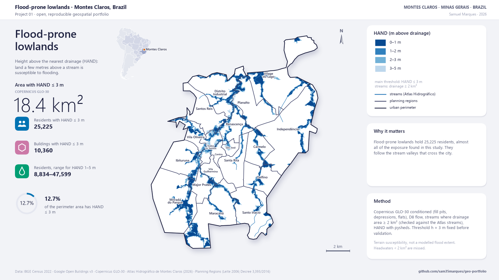
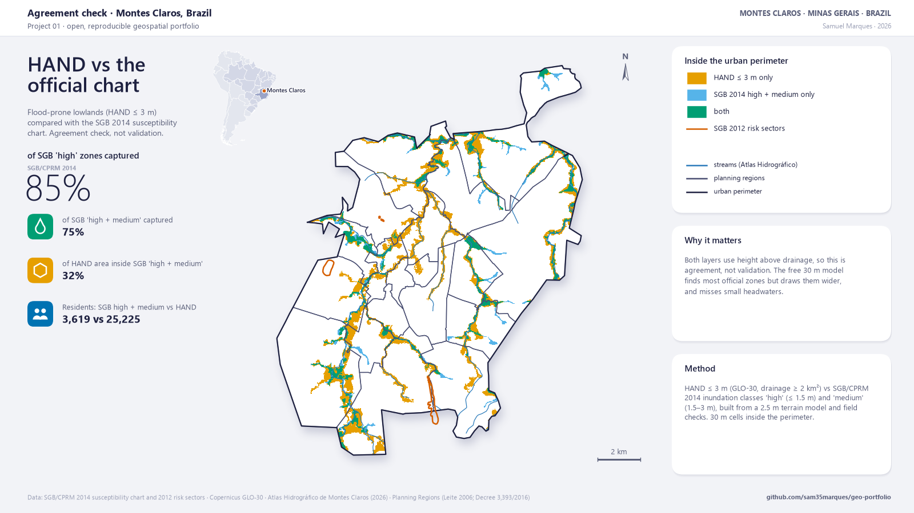
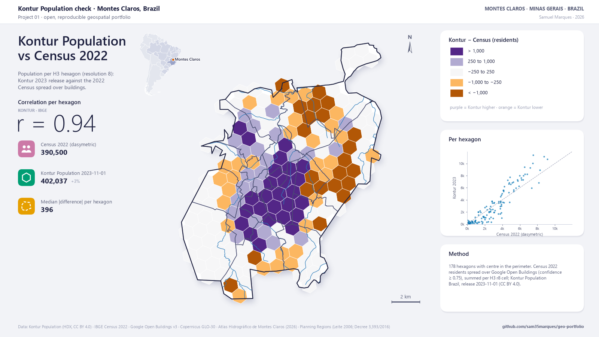
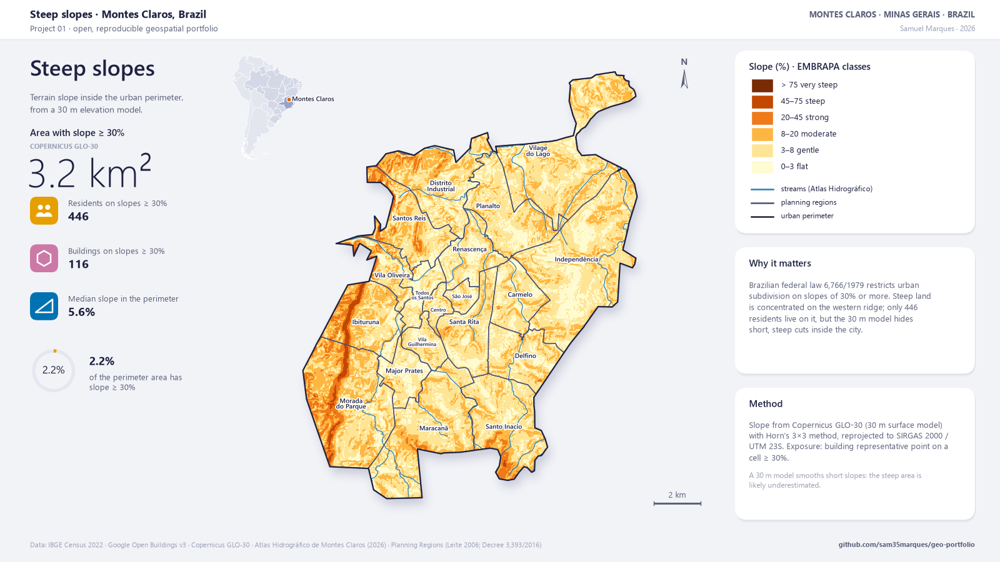

{fig-alt="Dashboard map of exposed residents per H3 hexagon in Montes Claros"}

[Full case study and code on GitHub](https://github.com/sam35marques/geo-portfolio/tree/main/projects/01-hazard-exposure-montes-claros){.btn .btn-primary}
[One-page summary (PDF)](hazard-exposure-montes-claros/one-pager.pdf){.btn .btn-outline-primary}
[Interactive map](hazard-exposure-montes-claros/exposure_map.html){.btn .btn-outline-primary}

## Problem

Montes Claros is a city of 414,240 people (Census 2022) in northern Minas Gerais. Its urban area grew along small streams and up the slopes of the surrounding hills. Local plans need to know how many people live in hazard-prone terrain, and where, at a scale finer than the census tract. This study builds that estimate from open data only.

This is an **exposure** study: it counts people in hazard-prone areas. It does not include vulnerability, so it does not measure risk.

{fig-alt="Location of Montes Claros in South America, Brazil and Minas Gerais"}

## Method

1. **Study area:** the 19 Planning Regions of the urban perimeter (145.2 km², 94.7% of the municipal population).
2. **Terrain:** Copernicus GLO-30 at 30 m, reprojected to SIRGAS 2000 / UTM 23S. Slope by Horn's method; steep means ≥ 30% (Brazilian subdivision law).
3. **HAND:** streams start at a 2 km² contributing area. Flood-prone means HAND ≤ 3 m, fixed before any comparison.
4. **Population:** Census 2022 tract population spread over Google Open Buildings v3 footprints (confidence ≥ 0.75), by footprint area.
5. **Exposure:** a building is exposed when its representative point falls in a hazard zone. Totals by Planning Region and H3 resolution 8 cell.
6. **Checks and sensitivity:** comparison with the SGB/CPRM 2014 susceptibility chart and with Kontur Population; reruns for HAND 1–5 m, streams 1–3 km² and building confidence 0.65–0.75.

## Results

| Hazard zone (main parameters) | Buildings | Residents | Share of residents |
|---|---:|---:|---:|
| Flood-prone (HAND ≤ 3 m, streams ≥ 2 km²) | 10,360 | 25,225 | 6.43% |
| Steep slope (≥ 30%) | 116 | 446 | 0.11% |
| SGB 2012 high-risk sectors | 125 | 254 | 0.06% |
| **Any of the above** | **10,556** | **25,827** | **6.58%** |
| All buildings in the perimeter | 152,726 | 392,218 | 100% |

Flood-prone low ground drives almost all the exposure. Maracanã (4,369 residents), Renascença (2,939) and Major Prates (2,595) have the most exposed people.

{fig-alt="Flood-prone areas by HAND in Montes Claros"}

The HAND ≤ 3 m zone covers 85.4% of the area that SGB 2014 classifies as *high* inundation susceptibility. This is agreement, not validation: the chart also uses height above drainage.

{fig-alt="HAND compared with the SGB 2014 susceptibility chart"}

Across 176 populated H3 r8 cells, the dasymetric estimate and Kontur Population agree with Pearson r = 0.944. Kontur's total is 3% higher.

{fig-alt="Kontur Population compared with the Census-based estimate per H3 cell"}

{fig-alt="Steep slopes in Montes Claros"}

## Limitations

- The HAND threshold matters most: with streams ≥ 2 km², flood-prone residents range from 9,377 (HAND ≤ 1 m) to 42,044 (HAND ≤ 5 m).
- HAND is a terrain index, not a flood model: no rainfall, discharge or return period.
- GLO-30 is a 30 m surface model; roofs and trees raise elevation, and canalized streams under streets are not visible.
- Population per building follows footprint area and ignores building height and use.

The full list, data table, licences and reproduction steps are in the [case study on GitHub](https://github.com/sam35marques/geo-portfolio/tree/main/projects/01-hazard-exposure-montes-claros).

## Interactive map

<iframe src="hazard-exposure-montes-claros/exposure_map.html" width="100%" height="640" style="border:1px solid #E3E6EE; border-radius:8px;" title="Interactive map of exposed residents per H3 hexagon"></iframe>
